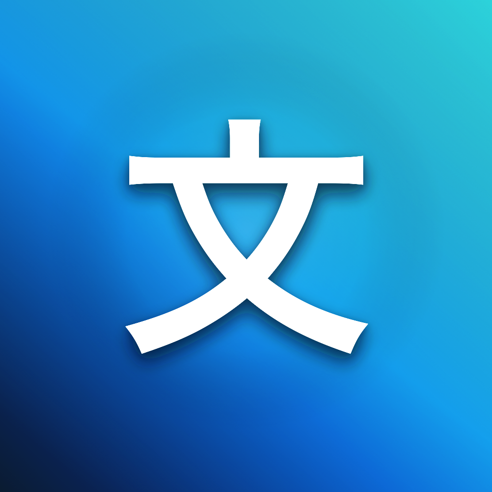
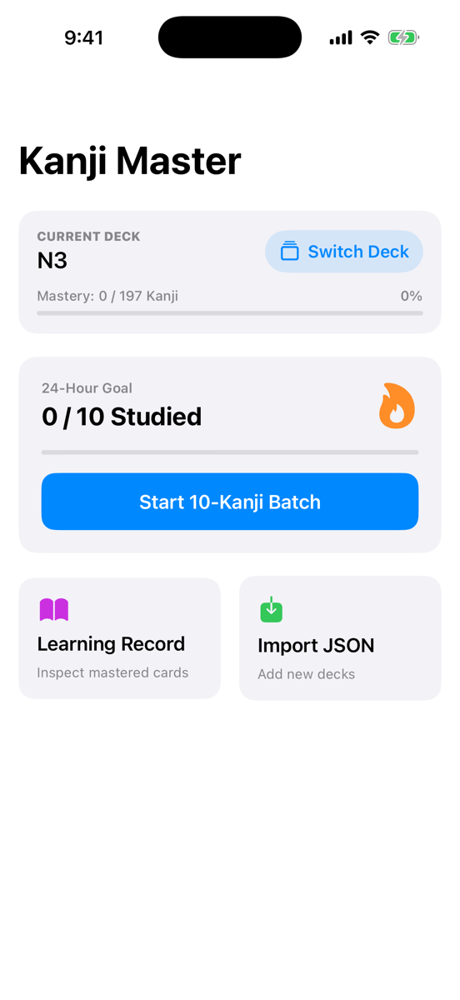
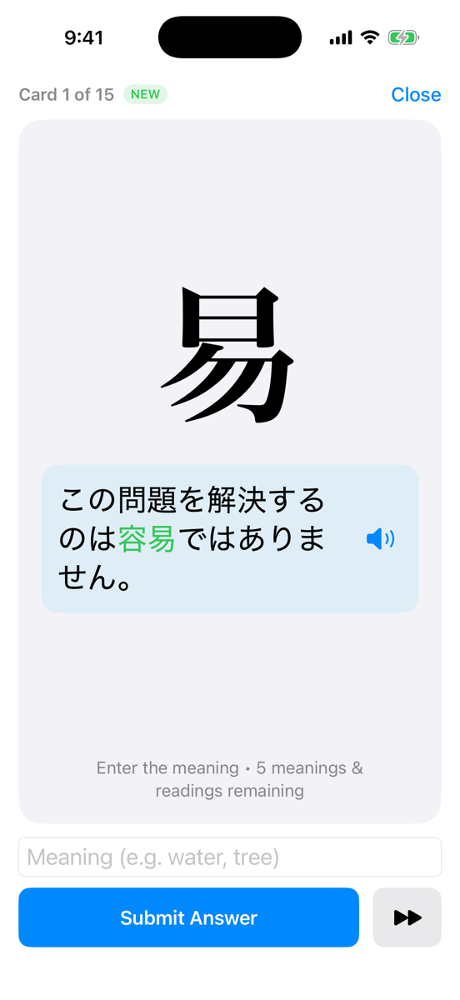
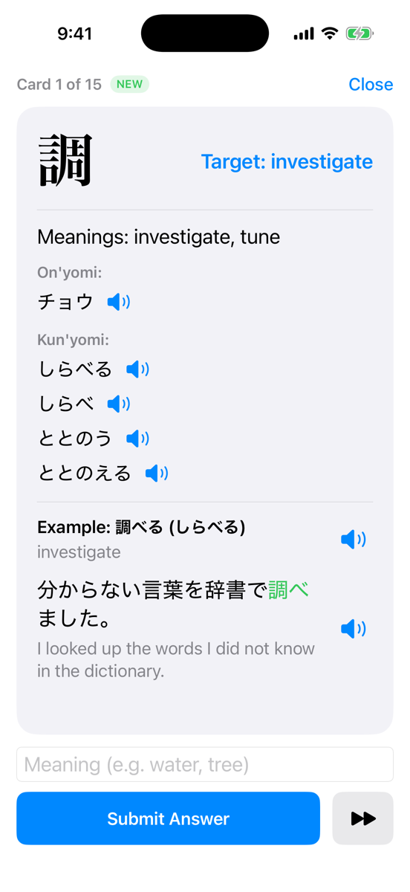

  

# KanjiMaster — JLPT Kanji Study

> **Coming soon to the Apple App Store.** KanjiMaster is currently in final preparation
> for release on iPhone. This repository is the public showcase of the project; the
> source code and data library are maintained in a private repository.

**KanjiMaster** is an iPhone app for studying JLPT kanji. It is built on a curated
library of kanji with meanings, readings, radicals, stroke data and example words — each
example with a Japanese sentence and English translation.

## Supported levels

| JLPT level | Kanji | Example words |
|---|---:|---:|
| N5 | 113 | 1,047 |
| N4 | 209 | 1,555 |
| N3 | 197 | 1,663 |
| **Total** | **519** | **4,265** |

## About the app

KanjiMaster is a SwiftUI iPhone app for learning JLPT N5–N3 kanji with flashcards. Each
card tests a single meaning or reading of a kanji, supported by a Japanese example
sentence that uses that exact reading, and progress is tracked until every meaning and
commonly used reading has been learned.

### Screenshots

#### Home screen

The current deck and its mastery progress, the 24-hour study goal, and shortcuts to the
Learning Record and deck import.

  

#### Study card — front (question)

The kanji, a Japanese context sentence with the word highlighted, and whether a meaning
or a reading is being asked.

  

#### Study card — back (answer)

All meanings and readings with pronunciation, plus the example word, sentence and English
translation for the item being tested.

  

### Features

- **Three bundled decks — N5, N4 and N3.** Switch between them from the home screen; the
  app remembers the last deck you studied. Progress is kept separately for each deck.
- **One question per card.** A card asks for either one meaning or one reading. Items are
  ordered by popularity, alternating meaning and reading, so common readings come first.
- **Context without giving the answer away.** The card front shows a Japanese sentence
  containing the kanji (highlighted in green) that uses the reading being tested, with no
  English. The back shows all meanings and readings, the example word, the sentence and
  its English translation.
- **Flexible answers.** Readings can be typed in romaji (converted to kana with a live
  preview) or kana; meanings get type-ahead suggestions from the deck. A correct but
  different reading, including a rare one, is accepted and recorded.
- **Pronunciation.** Speaker buttons read kanji readings, example words and sentences
  aloud using the built-in Japanese voice.
- **Daily study batches.** Each batch mixes up to 10 new and 5 review kanji, with a
  24-hour goal of 10 learned items shown on the home screen.
- **Learning Record.** Browse every kanji in the deck with its learned meanings and
  readings, and all example words with their sentences and translations.
- **Import JSON decks.** Load another deck file in the same format, choosing to merge with
  or reset existing progress for that level.

### How studying works

1. Start a batch from the home screen. Each card shows the kanji, the context sentence and
   what to enter (a meaning or a reading) and how many items remain for that kanji.
2. Enter an answer and submit. A correct answer is recorded and the next card appears.
   An incorrect answer flips the card to reveal the full details; tapping the card flips
   it at any time.
3. Entering something already learned does not count again — the app suggests flipping
   the card to review the example for the item being asked.
4. A kanji is **mastered** once all its meanings and all its *required* readings are
   learned. A reading is required when at least one example word in the deck uses it; rare
   readings are optional (accepted as answers, but never asked on their own card).

All progress is stored locally on the device.

## References

- **Kanji data:** entries (meanings, readings, radicals, stroke images and example words)
  are sourced from the JLPT kanji teaching materials at
  [langoal.com](https://langoal.com/teaching-materials/kanji/overview).
- **N1 and N2 levels:** not included. The source site only publishes N5, N4 and N3
  overviews.
- **Popularity data:** word commonness and reading popularity rankings are derived from
  [JMdict](https://www.edrdg.org/wiki/index.php/JMdict-EDICT_Dictionary_Project), © the
  Electronic Dictionary Research and Development Group, used under the
  [CC BY-SA 4.0 licence](https://www.edrdg.org/edrdg/licence.html).
